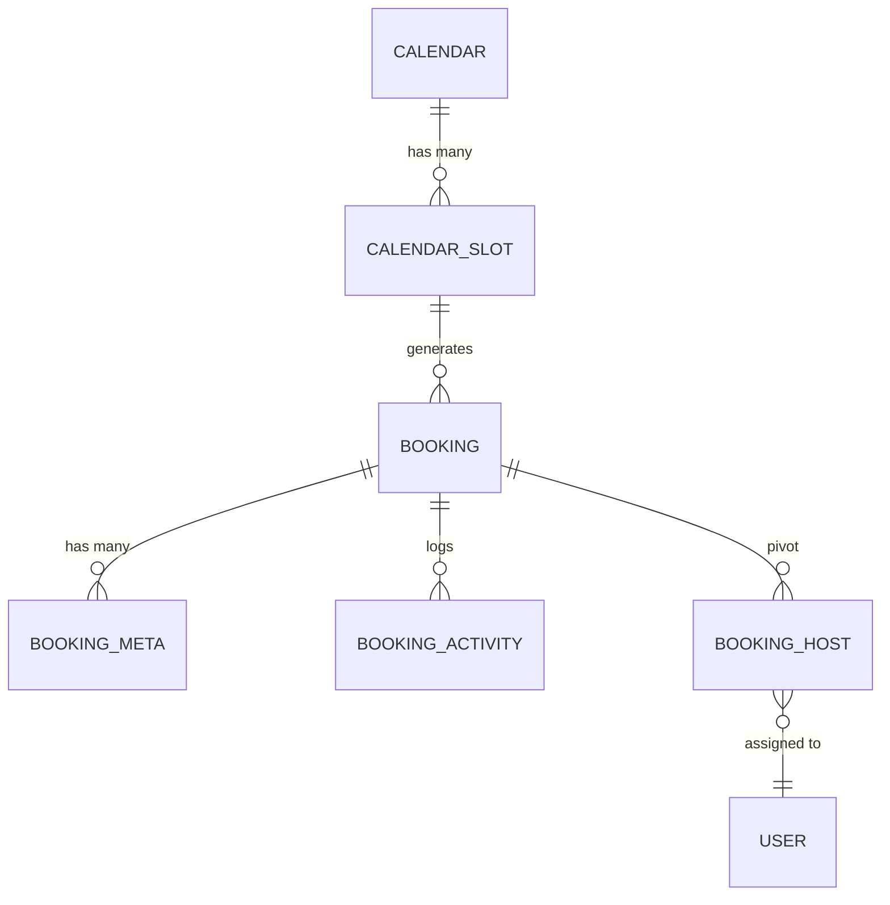

# 🔗 Model Relationships

Fluent Booking database tables are interconnected via primary and foreign key relationships. Our ORM makes managing these relationships effortless.

## Relationship Types

- **One-to-One**: A User has one profile.
- **One-to-Many**: A Calendar has many Events.
- **Many-to-Many**: A Booking has many Hosts (via `fcal_booking_hosts`).

## Visual Relationship Map



## Core Model Relationships

| Model | Relation | Type | Description |
|-------|----------|------|-------------|
| **Booking** | `calendar` | BelongsTo | The parent calendar |
| **Booking** | `hosts` | BelongsToMany | The assigned users/hosts |
| **Calendar** | `events` | HasMany | The booking slots/types |
| **User** | `calendars` | HasMany | Calendars owned by the user |

## Relationship Best Practices

### 1. Use Eager Loading
Avoid "N+1" query problems by using the `with()` method to load relationships in a single batch.

```php
// Good: Loads 10 bookings and their calendars in 2 queries
$bookings = Booking::with('calendar')->limit(10)->get();

foreach ($bookings as $booking) {
    echo $booking->calendar->title;
}
```

### 2. Relationship Constraints
You can filter a query based on the existence or properties of a relationship.

```php
// Get all calendars that have at least one active booking
$calendars = Calendar::has('bookings')->get();

// Get bookings for a specific event slug
$bookings = Booking::whereHas('calendar_event', function($query) {
    $query->where('slug', '15-min-meeting');
})->get();
```

## Performance Considerations

1. **Index Foreign Keys**: All relationship columns (like `calendar_id`, `event_id`, `user_id`) are indexed in the `fcal_` tables to ensure rapid joins.
2. **Select Specific Columns**: When eager loading, you can specify exactly which columns to retrieve to save memory.
   ```php
   $bookings = Booking::with('calendar:id,title,slug')->get();
   ```
3. **Lazy Loading Caution**: Accessing `$booking->calendar` without eager loading triggers a separate database query for every instance. Use this only for single-record views.
