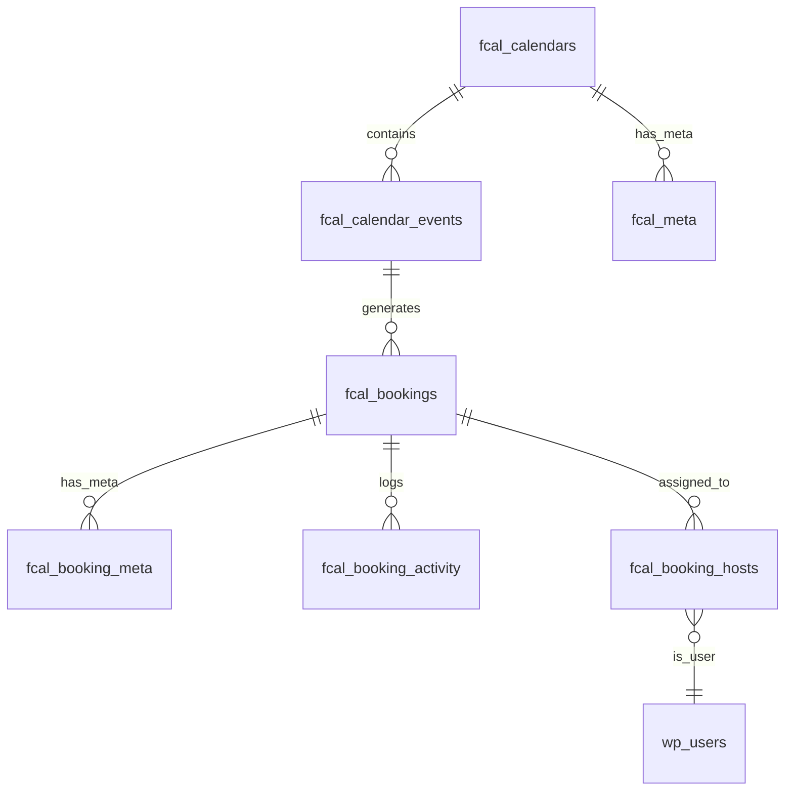

# 🗄️ Database Schema

The Fluent Booking database is designed for high performance, maintaining a clean separation between core scheduling data, host availability, and extensibility via metadata.

## Core Entity Relationships

🔍 **Interactive ER Diagram**
The following diagram illustrates the primary relationships between the core entity tables in Fluent Booking.

## Schema Overview

The Fluent Booking schema is built around these core concepts:

- **Calendars & Events**: Top-level containers for scheduling rules and specific appointment types.
- **Bookings**: The central ledger for all scheduled appointments, including customer data and status.
- **Availability & Rules**: Stored in a polymorphic meta system to allow for both global and event-specific overrides.
- **Multi-Host Management**: Pivot-based assignment for team scheduling, round-robin, and collective events.
- **Activity & Auditing**: Detailed logs for every state change or notification event related to a booking.
- **Pro Extensions**: Additional tables for Orders and Transactions to handle paid scheduling.

## Key Design Principles

1. **JSON Configuration**: Complex settings for events and calendars are stored as JSON for maximum flexibility without schema changes.
2. **Polymorphic Meta**: We use a unified `fcal_meta` table for various object types (Calendars, Events) to keep the core schema lean.
3. **Audit Trail**: Every significant booking event is logged in `fcal_booking_activity` for debugging and customer support.
4. **Performance Indexing**: Strategic composite indexes are placed on time-based columns (`start_time`, `end_time`) and foreign keys for rapid availability lookups.
5. **UUID / Hash Security**: Public identifiers are used for booking hashes and calendar slugs to prevent ID enumeration.

## Database Tables

All tables are prefixed with `fcal_` (or your custom WordPress prefix).

### `fcal_calendars`
The master table for calendars.
- `id`: Primary key
- `user_id`: Owner's WP User ID
- `hash`: Unique public identifier
- `title`: Calendar name
- `slug`: Public URL slug
- `type`: `simple` (individual), `team`, or `event`
- `author_timezone`: Host's default timezone
- `settings`: (JSON) Color, notification defaults, etc.
- `status`: `active` or `inactive`

### `fcal_calendar_events`
Represents bookable event types (Slots).
- `id`: Primary key
- `calendar_id`: Parent calendar
- `title`: Event name
- `slug`: Event public slug
- `duration`: Minutes
- `event_type`: `single`, `group`, `round_robin`, `collective`, etc.
- `location_type`: e.g., `google_meet`, `zoom_meeting`, `in_person`
- `settings`: (JSON) Buffer time, date ranges, etc.

### `fcal_bookings`
Stores all appointment records.
- `id`: Primary key
- `hash`: Public meeting identifier
- `calendar_id`: Related calendar
- `event_id`: Related event type
- `person_user_id`: Attendee WP User ID (if logged in)
- `start_time`: UTC start
- `end_time`: UTC end
- `status`: `scheduled`, `cancelled`, `completed`, `pending`
- `payment_status`: `pending`, `paid`, `refunded`, `failed`

### `fcal_orders` <Badge type="tip" text="Pro" />
Financial records for paid bookings.
- `id`: Primary key
- `parent_id`: Related [Booking](booking) ID
- `order_number`: Display ID
- `total_amount`: `DECIMAL(18,9)`
- `total_paid`: `DECIMAL(18,9)`
- `currency`: ISO code
- `status`: `pending`, `paid`, `refunded`

### `fcal_transactions` <Badge type="tip" text="Pro" />
Gateway-specific transaction logs.
- `id`: Primary key
- `object_id`: Related [Order](order) ID
- `vendor_charge_id`: Gateway reference ID
- `total`: `DECIMAL(18,9)`
- `status`: Payment status

### `fcal_meta`
Polymorphic storage for various objects.
- `object_type`: `Calendar`, `calendar_event`, `availability`, etc.
- `object_id`: Related ID
- `key`: Meta key
- `value`: (Serialized) Meta value

### `fcal_booking_meta`
Key-value storage for specific booking data (e.g., custom fields).

### `fcal_booking_activity`
Audit log for bookings.

### `fcal_booking_hosts`
Pivot table for multi-host bookings.
