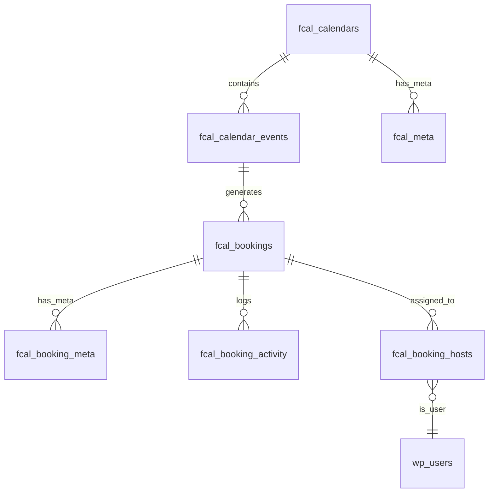

# 🗄️ Database Schema

The Fluent Booking database is designed for high performance, maintaining a clean separation between core scheduling data, host availability, and extensibility via metadata.

## Core Entity Relationships

🔍 **Interactive ER Diagram**
The following diagram illustrates the primary relationships between the core entity tables in Fluent Booking.

## Schema Overview

The Fluent Booking schema is built around these core concepts:

- **Calendars & Events**: Top-level containers for scheduling rules and specific appointment types.
- **Bookings**: The central ledger for all scheduled appointments, including customer data and status.
- **Availability & Rules**: Stored in a polymorphic meta system to allow for both global and event-specific overrides.
- **Multi-Host Management**: Pivot-based assignment for team scheduling, round-robin, and collective events.
- **Activity & Auditing**: Detailed logs for every state change or notification event related to a booking.
- **Pro Extensions**: Additional tables for Orders and Transactions to handle paid scheduling.

## Key Design Principles

1. **JSON Configuration**: Complex settings for events and calendars are stored as JSON for maximum flexibility without schema changes.
2. **Polymorphic Meta**: We use a unified `fcal_meta` table for various object types (Calendars, Events) to keep the core schema lean.
3. **Audit Trail**: Every significant booking event is logged in `fcal_booking_activity` for debugging and customer support.
4. **Performance Indexing**: Strategic composite indexes are placed on time-based columns (`start_time`, `end_time`) and foreign keys for rapid availability lookups.
5. **UUID / Hash Security**: Public identifiers are used for booking hashes and calendar slugs to prevent ID enumeration.

## Database Tables

All tables are prefixed with `fcal_` (or your custom WordPress prefix).

### `fcal_calendars`
The master table for calendars.
- `id`: Primary key
- `hash`: Unique public identifier
- `user_id`: Owner's WP User ID
- `account_id`: Associated integration account ID
- `parent_id`: Parent calendar ID (teams)
- `title`: Calendar name
- `slug`: Public URL slug
- `media_id`: Featured image ID
- `description`: Calendar description
- `settings`: (JSON) Color, notification defaults, etc.
- `status`: `active` or `inactive`
- `type`: `simple` (individual), `team`, or `event`
- `event_type`: Primary event category
- `account_type`: `free` / `pro`
- `visibility`: `public` / `hidden`
- `author_timezone`: Host's default timezone
- `max_book_per_slot`: Default guests limit per slot

### `fcal_calendar_events`
Represents bookable event types (Slots).
- `id`: Primary key
- `hash`: Unique public identifier
- `user_id`: Creator's WP User ID
- `calendar_id`: Parent calendar
- `duration`: Minutes
- `title`: Event name
- `slug`: Event public slug
- `media_id`: Featured image ID
- `description`: Event description
- `settings`: (JSON) Buffer time, date ranges, etc.
- `availability_type`: `existing_schedule` / `custom`
- `availability_id`: Linked availability ID
- `status`: `active` or `inactive`
- `type`: `free` / `paid`
- `color_schema`: Display color
- `location_type`: Primary location type
- `location_heading`: Custom label for location
- `location_settings`: (JSON) Multi-location config
- `event_type`: `single`, `group`, `round_robin`, `collective`, etc.
- `is_display_spots`: Show/hide remaining spots
- `max_book_per_slot`: Max guests limit

### `fcal_bookings`
Stores all appointment records.
- `id`: Primary key
- `hash`: Public meeting identifier
- `calendar_id`: Related calendar
- `event_id`: Related event type
- `group_id`: Group ID for multi-seat bookings
- `parent_id`: Parent ID for repeating bookings
- `host_user_id`: Assigned primary host
- `person_user_id`: Attendee WP User ID (if logged in)
- `person_contact_id`: CRM contact ID
- `person_time_zone`: Attendee's timezone
- `start_time`: UTC start
- `end_time`: UTC end
- `slot_minutes`: Booking duration
- `first_name`, `last_name`, `email`, `phone`: Attendee info
- `message`, `internal_note`: Notes/Message
- `location_details`: (JSON) Final location info
- `status`: `scheduled`, `cancelled`, `completed`, `pending`, `rescheduled`, `rejected`
- `payment_status`: `pending`, `paid`, `partially-paid`, `partially-refunded`
- `payment_method`: e.g., `stripe`, `paypal`
- `source`: `web` / `admin` / `api`
- `utm_source`, `utm_medium`, `utm_campaign`: Tracking params

### `fcal_orders` <Badge type="tip" text="Pro" />
Financial records for paid bookings.
- `id`: Primary key
- `parent_id`: Related [Booking](booking) ID
- `order_number`: Display ID
- `total_amount`: `DECIMAL(18,9)`
- `total_paid`: `DECIMAL(18,9)`
- `currency`: ISO code
- `status`: `pending`, `paid`, `refunded`

### `fcal_transactions` <Badge type="tip" text="Pro" />
Gateway-specific transaction logs.
- `id`: Primary key
- `object_id`: Related [Order](order) ID
- `vendor_charge_id`: Gateway reference ID
- `total`: `DECIMAL(18,9)`
- `status`: Payment status

### `fcal_meta`
Polymorphic storage for various objects.
- `object_type`: `Calendar`, `calendar_event`, `availability`, etc.
- `object_id`: Related ID
- `key`: Meta key
- `value`: (Serialized) Meta value

### `fcal_booking_meta`
Polymorphic key-value storage for specific booking data (e.g., custom fields).
- `booking_id`: Foreign key
- `meta_key`, `value`: Metadata pairs

### `fcal_booking_activity`
Detailed audit log for all booking actions.
- `booking_id`: Related booking
- `parent_id`: Parent activity ID (nested)
- `created_by`: WP User ID of actor
- `status`: Status of action (`open`, `resolved`)
- `type`: `activity`, `notification`, etc.
- `title`, `description`: Log details

### `fcal_booking_hosts`
Pivot table linking multiple hosts to a single booking.
- `booking_id`: Related booking
- `user_id`: Assigned host's WP User ID
- `status`: `confirmed`, `pending`

### `fcal_order_items` <Badge type="tip" text="Pro" />
Detailed line items for financial orders.
- `order_id`: Parent [Order](order)
- `booking_id`: Associated booking
- `item_name`: Display title
- `type`: `booking_slot`, `discount`, `tax`
- `quantity`, `item_price`, `item_total`: Financial data
