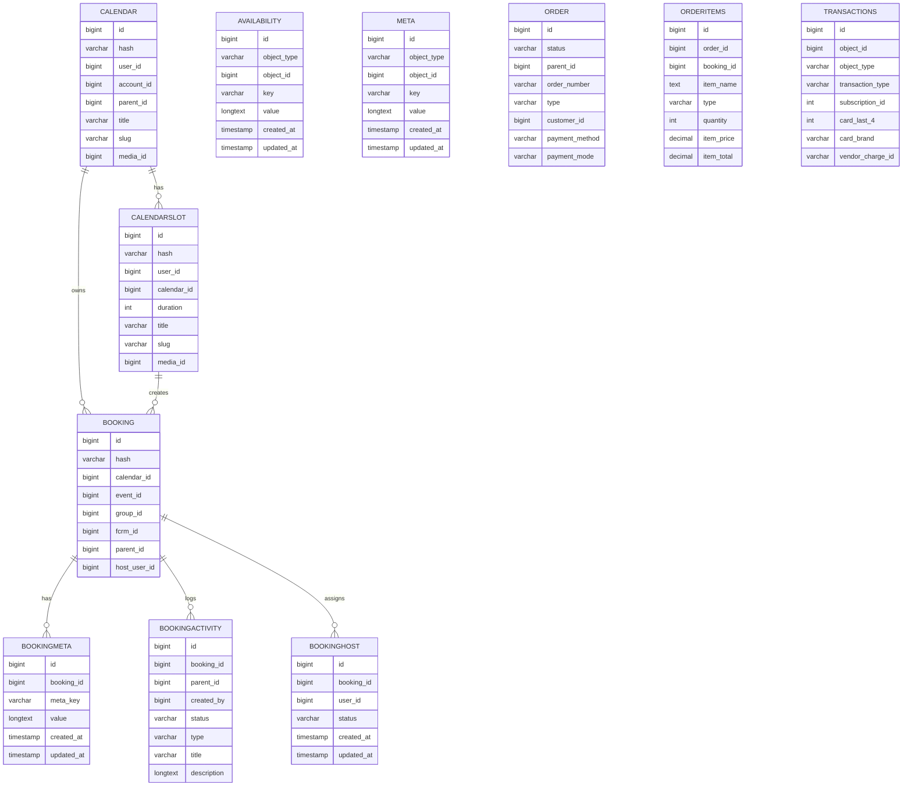

# Database Schema

FluentBooking stores all data in custom WordPress tables prefixed with `fcal_`. The schema below is parsed directly from the `CREATE TABLE` statements inside `database/Migrations/`, so the columns, types, and defaults reflect what is installed at activation.

## Tables

| Table | Model | Columns | Indexes |
| --- | --- | --- | --- |
| `fcal_bookings` | [Booking](/database/models/booking) | 42 | 7 |
| `fcal_calendars` | [Calendar](/database/models/calendar) | 19 | 6 |
| `fcal_calendar_events` | [CalendarSlot](/database/models/calendar-slot) | 23 | 5 |
| `fcal_meta` | [Availability](/database/models/availability) | 7 | 0 |
| `fcal_booking_activity` | [BookingActivity](/database/models/booking-activity) | 10 | 0 |
| `fcal_booking_hosts` | [BookingHost](/database/models/booking-host) | 6 | 3 |
| `fcal_booking_meta` | [BookingMeta](/database/models/booking-meta) | 6 | 0 |
| `fcal_meta` | [Meta](/database/models/meta) | 7 | 0 |
| `fcal_orders` | [Order](/database/models/order) | 27 | 0 |
| `fcal_order_items` | [OrderItems](/database/models/order-items) | 12 | 0 |
| `fcal_transactions` | [Transactions](/database/models/transactions) | 17 | 0 |

## Entity Relationship Diagram

## `fcal_bookings` (Booking)

> Migration source: `fluent-booking/database/Migrations/BookingMigrator.php`

| Column | Type | Nullable | Default | Description |
| --- | --- | --- | --- | --- |
| `id` | `BIGINT(20) UNSIGNED NOT NULL PRIMARY KEY` | Yes | `—` | Primary key for the row. |
| `hash` | `VARCHAR(192)` | Yes | `—` | Random hash used as a public, non-enumerable booking identifier. |
| `calendar_id` | `BIGINT(20) UNSIGNED` | No | `—` | Foreign key to `fcal_calendars`. |
| `event_id` | `BIGINT(20) UNSIGNED` | No | `—` | Foreign key to `fcal_calendar_events` (the CalendarSlot model). |
| `group_id` | `BIGINT(20) UNSIGNED` | Yes | `—` | Shared group ID for bookings created together (group / collective). |
| `fcrm_id` | `BIGINT(20) UNSIGNED` | Yes | `—` | Optional FluentCRM contact ID for the booker. |
| `parent_id` | `BIGINT(20) UNSIGNED` | Yes | `—` | Parent row used for rescheduled or grouped bookings. |
| `host_user_id` | `BIGINT(20) UNSIGNED` | Yes | `—` | WordPress user ID of the host that owns the booking. |
| `person_user_id` | `BIGINT(20) UNSIGNED` | Yes | `—` | WordPress user ID of the attendee, if they were logged in. |
| `person_contact_id` | `BIGINT(20) UNSIGNED` | Yes | `—` | FluentCRM contact ID for the attendee, when available. |
| `person_time_zone` | `VARCHAR(100)` | Yes | `—` | IANA timezone of the attendee at the time of booking. |
| `start_time` | `TIMESTAMP` | Yes | `—` | Booking start time in UTC. |
| `end_time` | `TIMESTAMP` | Yes | `—` | Booking end time in UTC. |
| `slot_minutes` | `INT(11) UNSIGNED` | No | `—` | Length of the booked slot in minutes. |
| `first_name` | `VARCHAR(192)` | Yes | `—` | Attendee first name. |
| `last_name` | `VARCHAR(192)` | Yes | `—` | Attendee last name. |
| `email` | `VARCHAR(192)` | Yes | `—` | Attendee email address. |
| `message` | `TEXT` | Yes | `—` | Free-form message submitted by the attendee. |
| `internal_note` | `TEXT` | Yes | `—` | Internal note visible only to hosts and admins. |
| `phone` | `VARCHAR(100)` | Yes | `—` | Attendee phone number (when collected). |
| `country` | `VARCHAR(100)` | Yes | `—` | Attendee country code (when collected). |
| `ip_address` | `VARCHAR(192)` | Yes | `—` | IP address recorded when the booking was created. |
| `browser` | `VARCHAR(192)` | Yes | `—` | Browser detected when the booking was created. |
| `device` | `VARCHAR(192)` | Yes | `—` | Device detected when the booking was created. |
| `other_info` | `LONGTEXT` | Yes | `—` | Serialized custom-field answers and miscellaneous attendee data. |
| `location_details` | `LONGTEXT` | Yes | `—` | Serialized location data (Zoom link, address, custom location). |
| `cancelled_by` | `BIGINT(20) UNSIGNED` | Yes | `—` | User ID of the person who cancelled the booking, if any. |
| `status` | `VARCHAR(20)` | No | `scheduled` | Lifecycle status (`scheduled`, `cancelled`, `completed`, `rejected`, `pending`). |
| `source` | `VARCHAR(20)` | No | `web` | How the booking was created (`web`, `api`, etc.). |
| `booking_type` | `VARCHAR(20)` | No | `scheduling` | Internal booking subtype. |
| `event_type` | `VARCHAR(20)` | No | `single` | `single` or `group` event. |
| `payment_status` | `VARCHAR(20)` | Yes | `—` | Payment lifecycle status (`pending`, `paid`, `refunded`). |
| `payment_method` | `VARCHAR(20)` | Yes | `—` | Selected payment method slug. |
| `source_url` | `TEXT` | Yes | `—` | Referring URL where the booking originated. |
| `source_id` | `BIGINT(20) UNSIGNED` | Yes | `—` | Generic foreign key for the source record (form ID, etc.). |
| `utm_source` | `VARCHAR(192)` | Yes | `` | Marketing UTM source value. |
| `utm_medium` | `VARCHAR(192)` | Yes | `` | Marketing UTM medium value. |
| `utm_campaign` | `VARCHAR(192)` | Yes | `` | Marketing UTM campaign value. |
| `utm_term` | `VARCHAR(192)` | Yes | `` | Marketing UTM term value. |
| `utm_content` | `VARCHAR(192)` | Yes | `` | Marketing UTM content value. |
| `created_at` | `TIMESTAMP` | Yes | `—` | Creation timestamp maintained by the ORM. |
| `updated_at` | `TIMESTAMP` | Yes | `—` | Update timestamp maintained by the ORM. |

**Indexes**

- `fcal_b_parent_id` on (`parent_id`)
- `fcal_b_hash` on (`hash`)
- `fcal_b_calendar_id` on (`calendar_id`)
- `fcal_b_fcrm_id` on (`fcrm_id`)
- `fcal_b_event_id` on (`event_id`)
- `fcal_b_booking_type` on (`booking_type`)
- `fcal_b_start_time` on (`start_time`)

## `fcal_calendars` (Calendar)

> Migration source: `fluent-booking/database/Migrations/CalendarMigrator.php`

| Column | Type | Nullable | Default | Description |
| --- | --- | --- | --- | --- |
| `id` | `BIGINT(20) UNSIGNED NOT NULL PRIMARY KEY` | Yes | `—` | Primary key for the row. |
| `hash` | `VARCHAR(192)` | Yes | `—` | Random hash used as a public, non-enumerable booking identifier. |
| `user_id` | `BIGINT(20) UNSIGNED` | No | `—` | WordPress user ID associated with the row. |
| `account_id` | `BIGINT(20) UNSIGNED` | Yes | `—` | Foreign key to a related record. |
| `parent_id` | `BIGINT(20) UNSIGNED` | Yes | `—` | Parent row used for rescheduled or grouped bookings. |
| `title` | `VARCHAR(192)` | No | `—` | Human-readable title stored for the record. |
| `slug` | `VARCHAR(192)` | No | `—` | Sanitized slug or public identifier. |
| `media_id` | `BIGINT(20) UNSIGNED` | Yes | `—` | Foreign key to a related record. |
| `description` | `LONGTEXT` | Yes | `—` | Description text stored for the record. |
| `settings` | `LONGTEXT` | Yes | `—` | Serialized settings payload. |
| `status` | `VARCHAR(20)` | No | `active` | Lifecycle status (`scheduled`, `cancelled`, `completed`, `rejected`, `pending`). |
| `type` | `VARCHAR(20)` | No | `simple` | Subtype discriminator. |
| `event_type` | `VARCHAR(20)` | No | `scheduling` | `single` or `group` event. |
| `account_type` | `VARCHAR(20)` | No | `free` | Account Type stored for this record. |
| `visibility` | `VARCHAR(20)` | No | `public` | Visibility stored for this record. |
| `author_timezone` | `VARCHAR(192)` | Yes | `UTC` | Author Timezone stored for this record. |
| `max_book_per_slot` | `INT(10) UNSIGNED` | No | `1` | Max Book Per Slot stored for this record. |
| `created_at` | `TIMESTAMP` | Yes | `—` | Creation timestamp maintained by the ORM. |
| `updated_at` | `TIMESTAMP` | Yes | `—` | Update timestamp maintained by the ORM. |

**Indexes**

- `fcal_c_user_id` on (`user_id`)
- `fcal_c_hash` on (`hash`)
- `fcal_c_status` on (`status`)
- `fcal_c_slug` on (`slug`)
- `fcal_c_event_type` on (`event_type`)
- `fcal_c_type` on (`type`)

## `fcal_calendar_events` (CalendarSlot)

> Migration source: `fluent-booking/database/Migrations/CalendarSlotsMigrator.php`

| Column | Type | Nullable | Default | Description |
| --- | --- | --- | --- | --- |
| `id` | `BIGINT(20) UNSIGNED NOT NULL PRIMARY KEY` | Yes | `—` | Primary key for the row. |
| `hash` | `VARCHAR(192)` | Yes | `—` | Random hash used as a public, non-enumerable booking identifier. |
| `user_id` | `BIGINT(20) UNSIGNED` | No | `—` | WordPress user ID associated with the row. |
| `calendar_id` | `BIGINT(20) UNSIGNED` | No | `—` | Foreign key to `fcal_calendars`. |
| `duration` | `INT(11) UNSIGNED` | No | `—` | Event length in minutes. |
| `title` | `VARCHAR(192)` | No | `—` | Human-readable title stored for the record. |
| `slug` | `VARCHAR(192)` | No | `—` | Sanitized slug or public identifier. |
| `media_id` | `BIGINT(20) UNSIGNED` | Yes | `—` | Foreign key to a related record. |
| `description` | `LONGTEXT` | Yes | `—` | Description text stored for the record. |
| `settings` | `LONGTEXT` | Yes | `—` | Serialized settings payload. |
| `availability_type` | `VARCHAR(192)` | Yes | `custom` | Availability Type stored for this record. |
| `availability_id` | `BIGINT(20) UNSIGNED` | Yes | `—` | Foreign key to a related record. |
| `status` | `VARCHAR(20)` | No | `active` | Lifecycle status (`scheduled`, `cancelled`, `completed`, `rejected`, `pending`). |
| `type` | `VARCHAR(20)` | No | `free` | Subtype discriminator. |
| `color_schema` | `VARCHAR(100)` | No | `default` | Color Schema stored for this record. |
| `location_type` | `VARCHAR(100)` | No | `` | Location Type stored for this record. |
| `location_heading` | `TEXT` | Yes | `—` | Location Heading stored for this record. |
| `location_settings` | `LONGTEXT` | Yes | `—` | Location Settings stored for this record. |
| `event_type` | `VARCHAR(20)` | No | `single` | `single` or `group` event. |
| `is_display_spots` | `BOOLEAN` | No | `0` | Is Display Spots stored for this record. |
| `max_book_per_slot` | `INT(10) UNSIGNED` | No | `1` | Max Book Per Slot stored for this record. |
| `created_at` | `TIMESTAMP` | Yes | `—` | Creation timestamp maintained by the ORM. |
| `updated_at` | `TIMESTAMP` | Yes | `—` | Update timestamp maintained by the ORM. |

**Indexes**

- `fcal_cs_user_id` on (`user_id`)
- `fcal_cs_hash` on (`hash`)
- `fcal_cs_status` on (`status`)
- `fcal_cs_slug` on (`slug`)
- `fcal_cs_type` on (`type`)

## `fcal_meta` (Availability)

> Migration source: `fluent-booking/database/Migrations/MetaMigrator.php`

| Column | Type | Nullable | Default | Description |
| --- | --- | --- | --- | --- |
| `id` | `BIGINT UNSIGNED NOT NULL PRIMARY KEY` | Yes | `—` | Primary key for the row. |
| `object_type` | `VARCHAR(50)` | No | `—` | Polymorphic object type for the meta row. |
| `object_id` | `BIGINT` | Yes | `—` | Polymorphic object ID for the meta row. |
| `key` | `VARCHAR(192)` | No | `—` | Meta key. |
| `value` | `LONGTEXT` | Yes | `—` | Meta value (often JSON-encoded). |
| `created_at` | `TIMESTAMP` | Yes | `—` | Creation timestamp maintained by the ORM. |
| `updated_at` | `TIMESTAMP` | Yes | `—` | Update timestamp maintained by the ORM. |

## `fcal_booking_activity` (BookingActivity)

> Migration source: `fluent-booking/database/Migrations/BookingActivityMigrator.php`

| Column | Type | Nullable | Default | Description |
| --- | --- | --- | --- | --- |
| `id` | `BIGINT UNSIGNED NOT NULL PRIMARY KEY` | Yes | `—` | Primary key for the row. |
| `booking_id` | `BIGINT UNSIGNED` | No | `—` | Foreign key to a related record. |
| `parent_id` | `BIGINT UNSIGNED` | Yes | `—` | Parent row used for rescheduled or grouped bookings. |
| `created_by` | `BIGINT UNSIGNED` | Yes | `—` | Created By stored for this record. |
| `status` | `VARCHAR(50)` | Yes | `open` | Lifecycle status (`scheduled`, `cancelled`, `completed`, `rejected`, `pending`). |
| `type` | `VARCHAR(50)` | Yes | `activity` | Subtype discriminator. |
| `title` | `VARCHAR(192)` | Yes | `—` | Human-readable title stored for the record. |
| `description` | `LONGTEXT` | Yes | `—` | Description text stored for the record. |
| `created_at` | `TIMESTAMP` | Yes | `—` | Creation timestamp maintained by the ORM. |
| `updated_at` | `TIMESTAMP` | Yes | `—` | Update timestamp maintained by the ORM. |

## `fcal_booking_hosts` (BookingHost)

> Migration source: `fluent-booking/database/Migrations/BookingHostMigrator.php`

| Column | Type | Nullable | Default | Description |
| --- | --- | --- | --- | --- |
| `id` | `BIGINT(20) UNSIGNED NOT NULL PRIMARY KEY` | Yes | `—` | Primary key for the row. |
| `booking_id` | `BIGINT(20) UNSIGNED` | No | `—` | Foreign key to a related record. |
| `user_id` | `BIGINT(20) UNSIGNED` | No | `—` | WordPress user ID associated with the row. |
| `status` | `VARCHAR(20)` | No | `confirmed` | Lifecycle status (`scheduled`, `cancelled`, `completed`, `rejected`, `pending`). |
| `created_at` | `TIMESTAMP` | Yes | `—` | Creation timestamp maintained by the ORM. |
| `updated_at` | `TIMESTAMP` | Yes | `—` | Update timestamp maintained by the ORM. |

**Indexes**

- `fcal_bu_booking_id` on (`booking_id`)
- `fcal_bu_user_id` on (`user_id`)
- `fcal_bu_status` on (`status`)

## `fcal_booking_meta` (BookingMeta)

> Migration source: `fluent-booking/database/Migrations/BookingMetaMigrator.php`

| Column | Type | Nullable | Default | Description |
| --- | --- | --- | --- | --- |
| `id` | `BIGINT UNSIGNED NOT NULL PRIMARY KEY` | Yes | `—` | Primary key for the row. |
| `booking_id` | `BIGINT` | Yes | `—` | Foreign key to a related record. |
| `meta_key` | `VARCHAR(192)` | No | `—` | Meta Key stored for this record. |
| `value` | `LONGTEXT` | Yes | `—` | Meta value (often JSON-encoded). |
| `created_at` | `TIMESTAMP` | Yes | `—` | Creation timestamp maintained by the ORM. |
| `updated_at` | `TIMESTAMP` | Yes | `—` | Update timestamp maintained by the ORM. |

## `fcal_meta` (Meta)

> Migration source: `fluent-booking/database/Migrations/MetaMigrator.php`

| Column | Type | Nullable | Default | Description |
| --- | --- | --- | --- | --- |
| `id` | `BIGINT UNSIGNED NOT NULL PRIMARY KEY` | Yes | `—` | Primary key for the row. |
| `object_type` | `VARCHAR(50)` | No | `—` | Polymorphic object type for the meta row. |
| `object_id` | `BIGINT` | Yes | `—` | Polymorphic object ID for the meta row. |
| `key` | `VARCHAR(192)` | No | `—` | Meta key. |
| `value` | `LONGTEXT` | Yes | `—` | Meta value (often JSON-encoded). |
| `created_at` | `TIMESTAMP` | Yes | `—` | Creation timestamp maintained by the ORM. |
| `updated_at` | `TIMESTAMP` | Yes | `—` | Update timestamp maintained by the ORM. |

## `fcal_orders` (Order)

> Migration source: `fluent-booking-pro/database/Migrations/BookingOrdersMigrator.php`

| Column | Type | Nullable | Default | Description |
| --- | --- | --- | --- | --- |
| `id` | `BIGINT UNSIGNED NOT NULL PRIMARY KEY` | Yes | `—` | Primary key for the row. |
| `status` | `VARCHAR(20)` | No | `draft` | Lifecycle status (`scheduled`, `cancelled`, `completed`, `rejected`, `pending`). |
| `parent_id` | `BIGINT UNSIGNED` | No | `—` | Parent row used for rescheduled or grouped bookings. |
| `order_number` | `VARCHAR(255)` | No | `` | Order Number stored for this record. |
| `type` | `VARCHAR(20)` | No | `sale` | Subtype discriminator. |
| `customer_id` | `BIGINT UNSIGNED` | No | `—` | Foreign key to a related record. |
| `payment_method` | `VARCHAR(100)` | No | `—` | Selected payment method slug. |
| `payment_mode` | `VARCHAR(100)` | No | `—` | Payment Mode stored for this record. |
| `payment_method_type` | `VARCHAR(100)` | No | `—` | Payment Method Type stored for this record. |
| `payment_method_title` | `VARCHAR(100)` | No | `—` | Payment Method Title stored for this record. |
| `currency` | `VARCHAR(10)` | No | `—` | Currency stored for this record. |
| `subtotal` | `DECIMAL(18,9)` | No | `0.000000000` | Subtotal stored for this record. |
| `discount_tax` | `DECIMAL(18,9)` | No | `0.000000000` | Discount Tax stored for this record. |
| `discount_total` | `DECIMAL(18,9)` | No | `0.000000000` | Discount Total stored for this record. |
| `shipping_tax` | `DECIMAL(18,9)` | No | `0.000000000` | Shipping Tax stored for this record. |
| `shipping_total` | `DECIMAL(18,9)` | No | `0.000000000` | Shipping Total stored for this record. |
| `tax_total` | `DECIMAL(18,9)` | No | `0.000000000` | Tax Total stored for this record. |
| `total_amount` | `DECIMAL(18,9)` | No | `0.000000000` | Total Amount stored for this record. |
| `total_paid` | `DECIMAL(18,9)` | No | `0.000000000` | Total Paid stored for this record. |
| `rate` | `DECIMAL(18,9)` | No | `1.000000000` | Rate stored for this record. |
| `note` | `TEXT` | No | `—` | Note stored for this record. |
| `ip_address` | `TEXT` | No | `—` | IP address recorded when the booking was created. |
| `completed_at` | `DATETIME` | Yes | `—` | Timestamp column. |
| `refunded_at` | `DATETIME` | Yes | `—` | Timestamp column. |
| `uuid` | `VARCHAR(100)` | No | `—` | Uuid stored for this record. |
| `created_at` | `TIMESTAMP` | Yes | `—` | Creation timestamp maintained by the ORM. |
| `updated_at` | `TIMESTAMP` | Yes | `—` | Update timestamp maintained by the ORM. |

## `fcal_order_items` (OrderItems)

> Migration source: `fluent-booking-pro/database/Migrations/OrdersItemsMigrator.php`

| Column | Type | Nullable | Default | Description |
| --- | --- | --- | --- | --- |
| `id` | `BIGINT(20) UNSIGNED NOT NULL PRIMARY KEY` | Yes | `—` | Primary key for the row. |
| `order_id` | `BIGINT UNSIGNED` | No | `0` | Foreign key to a related record. |
| `booking_id` | `BIGINT UNSIGNED` | No | `0` | Foreign key to a related record. |
| `item_name` | `TEXT` | No | `—` | Item Name stored for this record. |
| `type` | `VARCHAR(255)` | Yes | `—` | Subtype discriminator. |
| `quantity` | `INT` | No | `0` | Quantity stored for this record. |
| `item_price` | `DECIMAL(18,9)` | No | `0.000000000` | Item Price stored for this record. |
| `item_total` | `DECIMAL(18,9)` | No | `0.000000000` | Item Total stored for this record. |
| `rate` | `DECIMAL(18,9)` | No | `1.000000000` | Rate stored for this record. |
| `line_meta` | `TEXT` | Yes | `—` | Line Meta stored for this record. |
| `created_at` | `TIMESTAMP` | Yes | `—` | Creation timestamp maintained by the ORM. |
| `updated_at` | `TIMESTAMP` | Yes | `—` | Update timestamp maintained by the ORM. |

## `fcal_transactions` (Transactions)

> Migration source: `fluent-booking-pro/database/Migrations/BookingTransactionsMigrator.php`

| Column | Type | Nullable | Default | Description |
| --- | --- | --- | --- | --- |
| `id` | `BIGINT(20) UNSIGNED NOT NULL PRIMARY KEY` | Yes | `—` | Primary key for the row. |
| `object_id` | `BIGINT UNSIGNED` | No | `0` | Polymorphic object ID for the meta row. |
| `object_type` | `VARCHAR(100)` | No | `` | Polymorphic object type for the meta row. |
| `transaction_type` | `varchar(255)` | Yes | `one_time` | Transaction Type stored for this record. |
| `subscription_id` | `int(11)` | Yes | `—` | Foreign key to a related record. |
| `card_last_4` | `int(4)` | Yes | `—` | Card Last 4 stored for this record. |
| `card_brand` | `varchar(255)` | Yes | `—` | Card Brand stored for this record. |
| `vendor_charge_id` | `VARCHAR(192)` | No | `` | Foreign key to a related record. |
| `payment_method` | `VARCHAR(100)` | No | `` | Selected payment method slug. |
| `payment_method_type` | `VARCHAR(100)` | No | `` | Payment Method Type stored for this record. |
| `status` | `VARCHAR(20)` | No | `` | Lifecycle status (`scheduled`, `cancelled`, `completed`, `rejected`, `pending`). |
| `total` | `DECIMAL(18,9)` | No | `0.000000000` | Total stored for this record. |
| `rate` | `DECIMAL(10,5)` | No | `1.00000` | Rate stored for this record. |
| `uuid` | `VARCHAR(100)` | No | `` | Uuid stored for this record. |
| `meta` | `json` | Yes | `—` | Serialized meta payload. |
| `created_at` | `TIMESTAMP` | Yes | `—` | Creation timestamp maintained by the ORM. |
| `updated_at` | `TIMESTAMP` | Yes | `—` | Update timestamp maintained by the ORM. |
